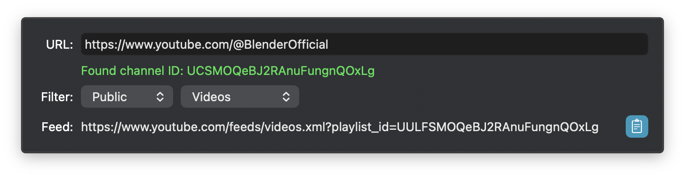

#  No BS YT Alfred Workflow

Make specialised YouTube RSS feeds

[⤓ Install on the Alfred Gallery](https://alfred.app/workflows/vitor/no-bs-yt)

## Usage

Generate a custom YouTube RSS feed from the most recent URL in your [Clipboard History](https://www.alfredapp.com/help/features/clipboard/) or the URL in the frontmost browser tab via the `nobsyt` keyword.

Set the filter to the types of videos you want to include in the feed and press <kbd>↩&#xFE0E;</kbd> to copy it to the clipboard.
